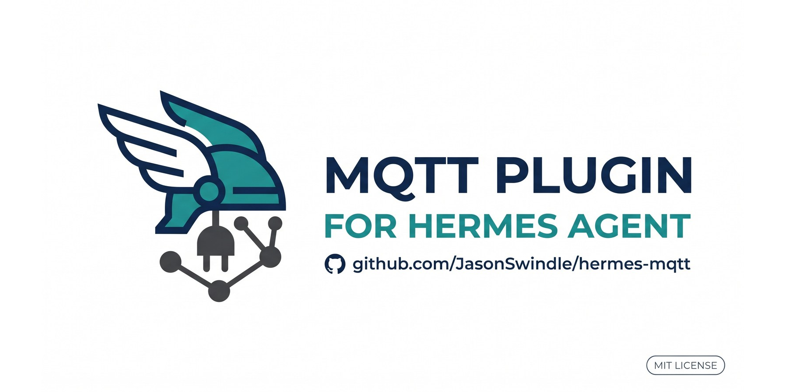

# MQTT as a Hermes platform

[](https://github.com/JasonSwindle/hermes-mqtt/actions/workflows/tests.yml)
[](LICENSE)
[](https://github.com/NousResearch/hermes-agent)

Connects [Hermes Agent](https://hermes-agent.nousresearch.com/docs) to an MQTT broker as
a first-class platform: one subscription, a per-topic policy, and a reply topic. The
client ships inside the plugin — standard library only, MQTT 3.1.1 and 5.0 over TCP or
TLS — so an image update that replaces the venv cannot take it away.

- **Inbound routes** — every message is matched to a policy: `deliver` pushes text to
  another platform for free, `agent` starts a turn, `job` fires an existing cron job,
  `drop` counts it. Anything unmatched is dropped, never escalated.
- **Outbound** — `send()` publishes a JSON envelope to `publish_topic`, deliberately
  outside the consumed namespace so a reply can never be re-consumed by this adapter.
- **No dependencies** — CONNECT/SUBSCRIBE/PUBLISH at QoS 0–1, keepalive, reconnect, TLS
  (`mqtts://`, verified by default, optional mTLS), and the v5 limits a broker actually
  enforces (Receive Maximum, Maximum Packet Size, Maximum QoS, Retain Available). Nothing
  to install, nothing to lose.

## At a glance

| | |
|---|---|
| Plugin name | `mqtt` |
| Registered platform | `mqtt` — the key under `platforms:` |
| Kind | `platform` — one gateway adapter: no tools, no hooks |
| Dependencies | none — standard library only |
| Protocols | MQTT 3.1.1 (level 4) and 5.0 (level 5), QoS 0–1 |
| Transport | TCP, or TLS (`mqtts://`, TLS 1.2+) with system/custom CA verification and optional mTLS |
| Tests | 222 stdlib unit tests, offline against a fake broker |
| Platforms | Linux, macOS (Apple Silicon) and Windows, Python 3.14 |
| Licence | MIT |
| Affiliation | Community plugin by Jason Swindle. Not affiliated with OASIS, Mosquitto, EMQX, HiveMQ or any broker vendor. |

## Why this exists

Hermes is turn-driven: something has to ask it. A house full of sensors, services and cron
jobs produces events continuously, and the usual answer is a poller or a webhook per
producer — one integration, one retry story, one credential per source.

An MQTT bus inverts that. Producers publish once to a topic; Hermes subscribes once and
decides per topic what an event is worth: a line delivered to a chat, an agent turn, an
existing cron job, or nothing. The bus carries fan-out and at-least-once delivery, Hermes
carries only the policy — so the agent reacts to the house instead of being asked about it.

That routing has to be cheap to be safe at sensor volume: `agent` is opt-in per topic
prefix and the default is silence. The client ships inside the plugin for a second reason —
a runtime may have no MQTT library, no `pip`, and a venv replaced on every image update —
but the point is the topology: Hermes on the bus, not a bridge daemon per producer.

## What actually changes when you enable it

| | Before | After |
|---|---|---|
| Broker traffic | nothing consumes it | one authenticated session per Hermes process |
| A message on `events/sensors.temp` | dropped at the broker | matched by prefix → `deliver` / `agent` / `job` / `drop` |
| Replies | — | published as JSON to `hermes/out` |
| Cost | $0 | $0 for `deliver`/`job`/`drop`, one turn for `agent` |

## Install

**From the plugin catalog** — find it with `hermes plugins search mqtt`:

```bash
hermes plugins install mqtt --enable
```

**Straight from this repository** (add `--ref <40-character sha>` to pin a reviewed commit):

```bash
hermes plugins install JasonSwindle/hermes-mqtt --enable
```

A git or catalog install lands as a **top-level plugin**, so it is enabled under the
plugin name `mqtt`. A manual clone behaves the same if you clone to
`~/.hermes/plugins/mqtt`; cloning under `plugins/platforms/` instead means the enable key
is `platforms/mqtt`.

```bash
git clone https://github.com/JasonSwindle/hermes-mqtt ~/.hermes/plugins/mqtt
hermes plugins enable mqtt
```

You also need a reachable broker (Mosquitto, EMQX, HiveMQ, …) and a dedicated user for
Hermes.

## Configuration

Credentials go in the environment (never in `config.yaml`):

```bash
MQTT_HERMES_URL=tcp://mqtt.example.com:1883
MQTT_HERMES_USER=mqtt-user
MQTT_HERMES_PASSWORD=***
# optional:
MQTT_SUBSCRIBE=events/#          # topic filter (default events/#)
MQTT_HERMES_PROTOCOL=auto       # auto (v5 then 3.1.1) | 5 | 3.1.1
MQTT_PUBLISH_TOPIC=hermes/out   # reply topic
# TLS (only used when the url scheme is mqtts://):
MQTT_HERMES_TLS_CA_FILE=/etc/hermes/mqtt-ca.pem   # private CA bundle; omit for system trust
MQTT_HERMES_TLS_CERT_FILE=/etc/hermes/mqtt-client.pem  # mutual TLS, optional
MQTT_HERMES_TLS_KEY_FILE=/etc/hermes/mqtt-client.key
MQTT_HERMES_TLS_KEY_PASSWORD=***                  # only for an encrypted client key
# MQTT_HERMES_TLS_SERVER_NAME=mqtt.internal       # cert name/SNI override (IP or proxy alias)
# MQTT_HERMES_TLS_INSECURE=true                   # UNSAFE: disables verification
```

Routing goes under `platforms.mqtt.extra`:

```yaml
platforms:
  mqtt:
    enabled: true
    extra:
      url: tcp://mqtt.example.com:1883
      username: mqtt-user
      subscribe: events/#          # MQTT filter; anything you widen it to must be routed below
      publish_topic: hermes/out    # outbound replies; keep it outside the subscription
      protocol: auto               # auto (v5 then 3.1.1) | "5" | "3.1.1"
      accept_retained: false       # retained messages are stale by definition
      topics:
        "sensors.": {mode: deliver, deliver: telegram, chat_id: <chat-id>}  # a LIVE gateway adapter
        "alerts.":  {mode: agent}
        "job.":     {mode: job, job_id: <cron job id or name>}
        # burst coalescing — agent/job only, opt-in; absent or 0 keeps one action per message:
        # "cloud.": {mode: job, job_id: <cron job id or name>, coalesce: 60, coalesce_max: 25}
      default: {mode: drop}
      max_concurrent: 4            # agent turns in flight before inbound backpressure
      max_packet_bytes: 16777216   # refuse inbound packets above 16 MiB (default)
      max_render_chars: 65536      # cap rendered prompt/delivery text (default 64 KiB)
      # TLS — only used when url is mqtts:// (default port 8883):
      tls_ca_file: /etc/hermes/mqtt-ca.pem      # private CA; omit for the system trust store
      tls_cert_file: /etc/hermes/mqtt-client.pem # mutual TLS identity (both halves required)
      tls_key_file: /etc/hermes/mqtt-client.key
      tls_key_password: ***                      # encrypted client key only (prefer env)
      tls_server_name: mqtt.internal             # cert name/SNI when connecting by IP
      tls_insecure: false                        # UNSAFE: disables verification
```

### TLS (`mqtts://`)

The scheme decides the transport — `mqtts://` (aliases `tls://`, `ssl://`) uses TLS on port
8883 by default; `tcp://`/`mqtt://` stay plaintext on 1883. There is no flag to enable TLS
on a plaintext URL and no fallback from a failed handshake to plaintext.

```yaml
url: mqtts://mqtt.example.com:8883              # system trust store, hostname verified
# or an internal CA / self-signed broker:
url: mqtts://mqtt.internal:8883
tls_ca_file: /etc/hermes/mqtt-ca.pem

# mutual TLS:
tls_cert_file: /etc/hermes/mqtt-client.pem
tls_key_file: /etc/hermes/mqtt-client.key
```

- **Verification is on by default**: certificate chain against the system trust store, or
  against `tls_ca_file` **as the only trust anchor** when it is set, plus hostname checking
  against the URL host. Certificate/hostname failures are reported as `mqtt_tls_failed`; on
  a first connect they are fatal, on a reconnect they stay retryable so a rotated cert/CA
  can recover.
- **`tls_server_name`** sets the certificate name and SNI when the URL host is an IP or a
  proxy alias but the certificate is for a DNS name.
- **`tls_insecure: true`** (`MQTT_HERMES_TLS_INSECURE`) turns verification off. It is a
  last-resort lab option: it logs a warning once per adapter and marks every connect log
  line as `TLS (verification disabled)`. It is never enabled implicitly.
- A TLS peer that closes cleanly *before CONNACK* after a good handshake is treated as a
  lost CONNACK, not a broken TLS stack: the MQTT protocol ladder may still try 3.1.1 (a
  3.1.1-only broker rejects a level-5 CONNECT by closing). If every level ends that way it
  is reported as `mqtt_tls_failed` and kept retryable, because a rejected or rotated client
  identity can be fixed without a restart. Record-level TLS alerts never fall back and
  never downgrade to plaintext.
- Certificate and CA files are re-read on every reconnect attempt, so a renewed certificate
  or a newly mounted secret recovers without restarting the gateway. Pointing `mqtts://` at a
  plaintext listener fails the handshake; a listener that accepts and then closes is reported
  as `mqtt_tls_failed` and retried — that case is ambiguous (wrong scheme/port, a rejected
  client identity, or a flaky peer), so check the scheme, port and TLS settings.

### Modes — pick the cheapest one that works

| mode | what happens | cost |
| --- | --- | --- |
| `deliver` | renders the message to text and pushes it to another Hermes platform (`deliver:` names a live gateway platform such as `telegram`; optional `profile:`, `chat_id:`, `thread_id:`) | **$0** — no agent, no tokens |
| `agent` | starts a real agent turn with the rendered message as the prompt | one turn |
| `job` | fires an existing cron job (`job_id:`), message body as transient run context | $0 |
| `drop` | counts it, logs once per topic | $0 |

**Unmatched topics are dropped**, never escalated.

`deliver:` must name a connected gateway adapter (`telegram`, `discord`, `slack`, …);
`local` is not a gateway adapter and is rejected instead of silently ACKing. With no
`chat_id`, the target platform's home channel is used — from the routed profile's adapter
when `profile:` is set, so a profiled policy with no home channel needs an explicit
`chat_id`. (A plugin cannot enter another profile's runtime scope, so the send itself runs
on this adapter; the adapter and home channel are the routed profile's.)

### Keys are prefixes, longest wins

`"sensors."` matches `sensors.temp` and `sensors.temp.kitchen`. `"sensors.temp"` also
matches `sensors.temp.kitchen` — a prefix has no path boundary, so end the key with the
separator (`.`) when you mean one. Ties break toward the longer key; nothing matches →
`default`.

Matching uses the envelope's `topic` first (the producer's own name, e.g.
`sensors.temp`), then the wire topic (`events/sensors.temp`), then the wire topic with the
subscription prefix stripped.

### Templates

Default for `deliver`: `{topic}: {summary}`. Default for `agent`:
`MQTT event on {mqtt_topic} from {source} at {occurred_at}:\n{json}`. Default for `job` is
the same text as `deliver`: `{topic}: {summary}`, passed as the job's transient run context.

Available: `{topic}`, `{mqtt_topic}`, `{source}`, `{event_id}`, `{occurred_at}`,
`{summary}`, `{json}` (producer payload, compact). Unknown keys render empty rather than
raising — a typo in a template must not lose an event.

### Bursts and cost

Every inbound message becomes its own action. For `deliver` and `drop` that action is cheap;
for `agent` and `job` it is not:

| mode | per-message cost | what one message spends |
| --- | --- | --- |
| `deliver` | **$0** — no agent | a render and a platform send |
| `agent` | one agent turn | tokens, latency, one `max_concurrent` slot |
| `job` | one cron firing, **$0** in tokens | a run of a job that is not necessarily idempotent |
| `drop` | $0 | a counter |

Bursts are normal on MQTT. QoS 1 is at-least-once, a broker replays retained messages to a
matching subscriber (`accept_retained: false`, the default, keeps them from becoming actions),
and a producer that reconnects publishes again whatever it could not confirm. A real
producer — a GitHub App feed — emits 4–7 messages within two seconds. Dedupe does not help: it
suppresses the *same* `event_id`, not distinct events arriving together. Wired straight to
`agent` or `job`, one burst is 4–7 turns or firings.

`max_concurrent` (default 4) bounds concurrency, not volume: it caps how many actions run at
once, not how many run. The inbox holds 1000 entries, and every entry becomes its own action.

**Coalescing is opt-in, per policy, for `agent` and `job` only.** Messages matched to the same
prefix collect in one bucket, and one action receives the whole batch:

```yaml
topics:
  "cloud.":  {mode: job, job_id: c9efb999c13b, coalesce: 60, coalesce_max: 25}
  "alerts.": {mode: agent, coalesce: 15}
```

- `coalesce` — window in seconds, counted from the first message of the current batch.
  Absent or `0` (the default) leaves every message on today's per-message path. Clamped to
  0–3600.
- `coalesce_max` — flush early at this many messages; default 25, clamped to 2–1000, ignored
  when `coalesce` is absent or 0.
- Both keys are per policy — a `default:` policy included — so `"cloud."` and `"alerts."` can
  run different windows.
- `deliver` and `drop` ignore both keys; their messages are never batched.

A batch is one action:

- **One bucket per matched prefix**, not per leaf topic: `cloud.github.push` and
  `cloud.github.review` share a `cloud.` batch. Arrival order is preserved, duplicates are
  filtered before buffering, and an accepted retained message joins the bucket like any
  other. A `default:` policy has no prefix, so its bucket and log lines say `default`.
- **Flush** when the window elapses, when the batch reaches `coalesce_max` (a fresh window
  then starts), on `disconnect()` before the adapter reports disconnected, and on the fatal
  reconnect path. At most 256 buckets are live at once; creating the 257th flushes the oldest
  bucket immediately instead of dropping it.
- **One rendered string** per action — a header, then each event with the existing template
  for the mode (or the policy's `template`):

  ```
  N events on <prefix> in <window>s
  <rendered event 1>

  <rendered event 2>
  ```

  The total is capped at `max_render_chars`; a batch that does not fit is truncated with
  `… truncated: N more events not shown` and still dispatched. A `job` gets the batch string
  as its transient run context; an `agent` gets one `MessageEvent` whose id is the first
  event's `event_id`.

**Counters count actions.** With coalescing on, `_counts.agent` and `_counts.job`
increment once per batch — a batch of 5 is `+1`, not `+5`. A new `coalesced_messages` counter
counts the messages that entered a bucket, and a failed flush increments `_counts.errors` once
per batch (and logs the batch size). The disconnect line,
`[mqtt] disconnected (modes seen: …)`, includes `coalesced_messages`; every flush logs
`[mqtt] coalesced N messages on <prefix> → <mode>` (`default` for a default-policy bucket).

## Behaviour

- **Dedupe** on `event_id`, 1 h / 4096 entries. MQTT is at-least-once; producers retry.
  Events without an `event_id` are all delivered — a content fingerprint would wrongly
  silence a periodic producer that publishes an identical body. Oversized ids are hashed
  before they reach the cache.
- **Coalescing is opt-in.** An `agent`/`job` policy with `coalesce` batches messages matched
  to its prefix into one rendered action, flushed on the window, at `coalesce_max`, on
  disconnect or on a fatal reconnect; at most 256 prefix buckets are live and the oldest is
  flushed rather than dropped. `deliver`/`drop` are never batched, and with `coalesce` absent
  every message keeps its current path. See [Bursts and cost](#bursts-and-cost).
- **Own-topic guard**: only `publish_topic` and its descendants are ignored inbound, so a
  widened subscription can never consume this adapter's own replies — and a sibling topic
  such as `hermes/state` is still routed normally.
- **Backpressure with counted drops**: inbound messages land in a bounded queue;
  `max_concurrent` worker slots cap concurrent agent turns — it bounds concurrency, not
  volume (see [Bursts and cost](#bursts-and-cost)). A full queue drops with a
  warning and a counter. QoS 1 is PUBACKed only after the message is queued (so an ack
  never promises a message the adapter threw away) and the keepalive runs in its own task,
  so a slow consumer cannot silence PINGREQ. A packet larger than `max_packet_bytes`
  (default 16 MiB) ends the session instead of being buffered, and rendered text is capped
  at `max_render_chars` (default 64 KiB) with an explicit truncation marker.
- **Reconnect** with 2/5/15/30/60 s backoff and jitter. A refused credential
  (`bad username or password`, `not authorised`), a refused subscription, or a permanent
  CONNACK refusal is fatal and reported to the gateway — it will not spin. A missing
  SUBACK or a dropped socket is transient and keeps retrying. A credential failure on a
  *reconnect* is reported retryable, so the gateway keeps watching for a fixed `.env`.
- **Protocol negotiation**: `auto` tries 5.0 then 3.1.1 over TCP or TLS, and falls back not
  just on CONNACK `0x84` but also when a 3.1.1-only broker answers with its own v3 CONNACK
  or just closes the socket (both are valid ways for a v3 broker to reject a level-5
  CONNECT).
- **Inbound validation**: a malformed packet ends the session instead of being routed —
  truncated frames, non-minimal lengths, invalid UTF-8/U+0000 topics, wildcard or empty
  PUBLISH topics, QoS 3 flag bits, unsupported topic aliases, duplicate CONNACK properties,
  session-present after Clean Start, and invalid fixed-header flags on control packets.
- **Agent session identity** comes from configuration, never the payload: a policy's
  `chat_id:` or the matched topic prefix (e.g. `alerts.`) keys the conversation, so a
  producer cannot create unbounded sessions by varying its topic.
- **Command isolation**: an inbound payload can never drive a gateway command. Agent-mode
  events set `allow_gateway_control=False` and the platform disables `/update`, so text
  such as `/update` inside a payload stays conversational.
- **Delivery routing**: a `deliver` policy may name a `profile:`; the reply goes through
  that profile's adapter and its own home channel, with `thread_id:` passed through when
  set. A named profile with no home channel requires an explicit `chat_id:`.
- **Offline gaps**: every connection is Clean Start with Session Expiry 0, so events the
  broker publishes while Hermes is disconnected are not queued for it (retained publishes
  still replay unless `accept_retained` is false). Producers that cannot tolerate gaps
  should retain their messages.
- **`trusted_inbound`**: the broker authenticates the connection, so the publisher is a
  service, not a person. Allowlists and pairing do not apply; nothing in the payload is
  trusted for authorization. Do **not** copy this flag to a platform a human can send to.
- `interactive_resume = False` — there is nobody on the other end of a topic to answer.

## The client

`mqtt_client.py` is a self-contained client (stdlib only) that speaks **MQTT 3.1.1 (level
4)** and **MQTT 5.0 (level 5)**: CONNECT/CONNACK, SUBSCRIBE/SUBACK, PUBLISH/PUBACK at QoS
0–1, PINGREQ/PINGRESP, reconnect. `protocol: auto` (the default) tries 5.0 first and falls
back to 3.1.1 when the broker answers CONNACK `0x84`, answers with a v3 CONNACK, or
closes before CONNACK; pin it with `protocol: "5"` or `protocol: "3.1.1"`. A password
without a username is legal on 5.0 (3.1.1 still requires a username). On 5.0 it enforces the broker's Receive Maximum, Maximum Packet Size, Maximum
QoS and Retain Available, and treats invalid limits (Receive Maximum 0, Maximum Packet Size
0, Maximum QoS above 1) as protocol errors. It subscribes with Retain Handling 2 so retained
messages never replay, and malformed packets (invalid framing, flags, UTF-8 or properties) end the
session instead of being routed. It also speaks TLS (`mqtts://`, TLS 1.2+ with certificate
and hostname verification, optional custom CA/mTLS/insecure opt-in). Still no will, no QoS
2. The wire codecs live in `mqtt_codec.py`; the session keeps the socket, TLS context, pump
and keepalive. The implemented-versus-
supported matrix is in [docs/CONFORMANCE.md](docs/CONFORMANCE.md).

## Tests

The tests import the Hermes gateway package, so point `PYTHONPATH` at your Hermes install
(the directory containing `gateway/`) plus its site-packages. Run them from the repo root;
the checkout directory name does not matter — `tests/_bootstrap.py` registers the package
under `mqtt` either way.

```bash
PYTHONPATH=/path/to/hermes:/path/to/hermes/.venv/lib/python3.14/site-packages \
  python -m unittest discover -s tests -v
```

Expected: `Ran 222 tests … OK`. Nineteen are the coalescing suite
(`tests/test_coalesce.py`): per-prefix buckets, the flush triggers, batch rendering and
truncation, the counter semantics, and the disabled-by-default, `deliver` pass-through,
invalid-value clamping and 256-bucket-bound cases. Three are wire end-to-end tests
(`tests/test_e2e.py`): a fake broker on a loopback socket feeds a real `MqttSession` and the
real router, with only the far-side delivery stubbed. The fake broker re-implements framing
independently, so an encoder bug cannot be mirrored by its own test. CI runs the suite on
Linux, macOS and Windows against Python 3.14 — Hermes's own dependency set is 3.14-only, and
the tests import it. macOS coverage is Apple Silicon only (`macos-latest` is arm64); **Intel
Macs are not tested and are not supported.**

There is also a check CI cannot run, because it needs a broker and credentials:

```bash
python scripts/e2e_live.py --dry-run                       # resolve the broker, connect nothing
python scripts/e2e_live.py --topic test.hello              # publish one real envelope
python scripts/e2e_live.py --verify-log /path/to/agent.log # find the gateway's delivered line
```

It reads `MQTT_HERMES_URL`/`_USER`/`_PASSWORD` (and `MQTT_HERMES_PROTOCOL` for pinning),
falling back to `/opt/data/.env`; `mqtts://` URLs work out of the box, with
`MQTT_HERMES_TLS_CA_FILE`/`_CERT_FILE`/`_KEY_FILE`/`_SERVER_NAME`/`_INSECURE` (or the
matching `--tls-*` flags) for a private CA, mTLS or an override. The log check is the
second, independent channel that proves the event was routed, not just sent.

## Operational notes

- `mosquitto_passwd -b <file> <user> <password>` writes a user; **Mosquitto only reloads
  the password file on SIGHUP** — `docker kill -s HUP <container>` after adding one, or the
  new credential is refused as `not authorised`.
- Scope the account with an `acl_file`: read on the subscription filter, write on
  `publish_topic`, nothing else. Test the ACL on a spare listener first; a malformed ACL
  locks out every client on the broker.
- A TLS listener is a different broker port (typically 8883, sometimes 8083 behind a
  proxy): keep the certificate's SAN matching the host Hermes dials, or set
  `tls_server_name`. Renew certs before they expire — the reconnect path picks up new files
  automatically, but verification failures are fatal while they last.
- `wss://` (MQTT over WebSockets) is **not implemented**; see
  [docs/WEBSOCKET-PLAN.md](docs/WEBSOCKET-PLAN.md) for the planned follow-up.

## Security

The client speaks **TCP or TLS**. Prefer `mqtts://` whenever the network is not fully
trusted: certificates and hostnames are verified by default, with an optional private CA,
mutual TLS, and an explicit `tls_insecure` opt-out that logs a warning. Plain `tcp://` is
still supported for a trusted LAN/loopback listener, and the broker account should be scoped
with an ACL rather than broker-wide rights. Inbound payloads are data, never commands:
agent-mode events cannot control the gateway and `/update` is disabled for this platform.
Inbound packets above `max_packet_bytes` are refused before allocation. See
[SECURITY.md](SECURITY.md) for the reporting policy and the exact trust boundary.

## License

MIT — see [LICENSE](LICENSE).
